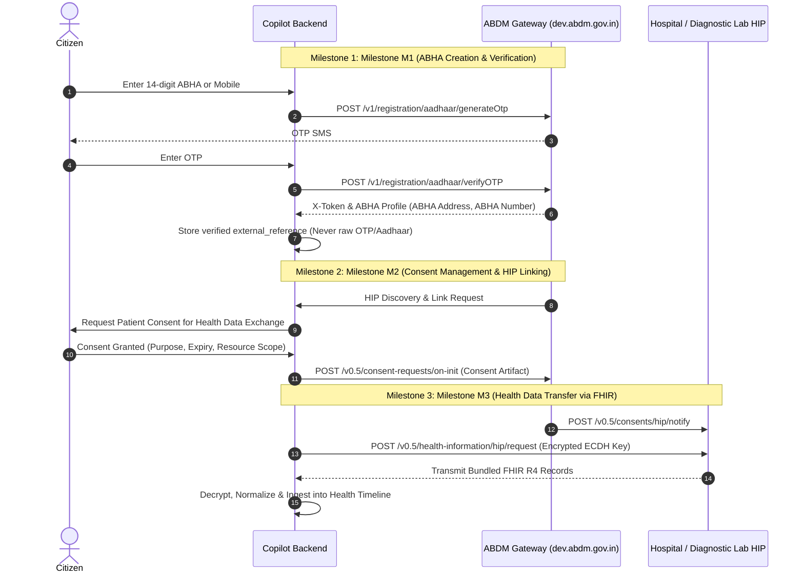

# AI-Powered Personal Health Copilot - ABDM / ABHA Integration Architecture & Pathway

## 1. Executive Summary
The Ayushman Bharat Digital Mission (ABDM) promotes an interoperable digital health ecosystem across India through:
1. **ABHA (Ayushman Bharat Health Account)**: A 14-digit national health identity enabling citizens to link, store, and share digital health records.
2. **HRP (Health Repository Provider) & HIP/HIU (Health Information Provider / User)**: Decentralized standards-based health information exchange orchestrated via the ABDM Gateway.
3. **FHIR R4**: Standardized clinical resource packaging (`DiagnosticReport`, `Prescription / MedicationRequest`, `DischargeSummary`, `OPConsultation`).

---

## 2. Mock vs Sandbox vs Production Architecture

To adhere strictly to healthcare safety and challenge constraints without making unverified claims:
- **Active Prototype Mode (`ABHA_PROVIDER=mock`)**: An explicitly simulated sandbox workflow displaying clearly fictional identifiers (e.g. `MOCK-ABHA-0001`). It demonstrates the complete citizen-facing linking and revocation experience with 0 false claims.
- **Pluggable Provider Pattern (`ABHAProvider`)**:
  ```python
  class ABHAProvider(ABC):
      @abstractmethod
      async def initiate_link(self, patient_id: UUID, abha_id: str) -> dict: ...
      @abstractmethod
      async def verify_otp(self, patient_id: UUID, transaction_id: str, otp: str) -> dict: ...
      @abstractmethod
      async def get_status(self, patient_id: UUID) -> dict: ...
      @abstractmethod
      async def revoke_link(self, patient_id: UUID) -> dict: ...
  ```

---

## 3. Official ABDM Gateway Integration Roadmap

When official sandbox access and National Health Authority (NHA) credentials (`client_id`, `client_secret`) are provisioned:



---

## 4. FHIR R4 Resource Mapping Layer

The prototype persists all extracted medical facts in FHIR-compatible structures:
- **`DiagnosticReport`**: Laboratory investigations and clinical impressions
- **`Observation`**: Individual quantitative metrics (`Fasting Blood Glucose`, `HbA1c`, `Total Cholesterol`) referencing LOINC coding systems and numerical boundaries
- **`MedicationRequest`**: Prescriptions containing dosage timing, duration, and practitioner references
- **`Encounter`**: Clinic visits, outpatient consultations, and hospital encounters
