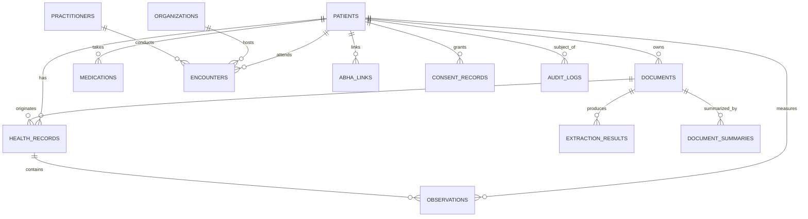

# AI-Powered Personal Health Copilot - Database Schema

## 1. Relational Entity Overview

The storage layer is engineered on PostgreSQL (managed via Supabase) with Row Level Security (RLS) enabled on all patient-associated tables. Internal UUID identifiers (`uuid-ossp`) are enforced across all entities.

---

## 2. Table Specifications

### 2.1 `patients`
| Column | Type | Constraints | Description |
|---|---|---|---|
| `id` | UUID | PRIMARY KEY | Internal persistent patient identifier (Never ABHA) |
| `user_id` | UUID | NOT NULL | Authentication UID mapping to Supabase Auth |
| `full_name` | TEXT | NOT NULL | Synthetic / genuine patient full name |
| `date_of_birth` | DATE | NULL | Date of birth |
| `gender` | TEXT | CHECK IN ('male', 'female', 'other', 'unknown') | Biological / demographic sex |
| `blood_group` | TEXT | NULL | e.g. B+, O-, A+ |
| `contact_phone` | TEXT | NULL | Contact phone number |
| `email` | TEXT | NULL | Patient email address |
| `preferred_language` | TEXT | DEFAULT 'en' | Preferred UI & summary language ('en', 'ta', 'hi') |
| `created_at` | TIMESTAMPTZ | DEFAULT now() | Record creation timestamp |
| `updated_at` | TIMESTAMPTZ | DEFAULT now() | Record modification timestamp |

### 2.2 `documents`
| Column | Type | Constraints | Description |
|---|---|---|---|
| `id` | UUID | PRIMARY KEY | Unique document identifier |
| `patient_id` | UUID | FK -> patients(id) ON DELETE CASCADE | Associated patient |
| `storage_path` | TEXT | NOT NULL | Private object storage path (e.g. `patient_01/docs/cbc.pdf`) |
| `original_filename`| TEXT | NOT NULL | File name at upload time |
| `mime_type` | TEXT | NOT NULL | Validated MIME type (PDF, JPEG, PNG) |
| `file_size_bytes` | BIGINT | NULL | Byte length of document |
| `document_type` | TEXT | CHECK IN ('prescription', 'lab_report', 'discharge_summary', 'radiology_report', 'other') | Classified document type |
| `document_date` | DATE | NULL | Date recorded in document body |
| `processing_status`| TEXT | CHECK IN ('uploaded', 'queued', 'processing', 'awaiting_review', 'completed', 'failed') | Lifecycle state |
| `error_message` | TEXT | NULL | Failure diagnosis when status is 'failed' |

### 2.3 `extraction_results`
| Column | Type | Constraints | Description |
|---|---|---|---|
| `id` | UUID | PRIMARY KEY | Unique extraction job record |
| `document_id` | UUID | FK -> documents(id) ON DELETE CASCADE | Target source document |
| `raw_ocr_text` | TEXT | NULL | Unmodified text returned by OCR engine |
| `structured_candidate_data` | JSONB | NOT NULL | Pydantic-validated candidate extraction schema |
| `extraction_provider` | TEXT | DEFAULT 'sarvam' | OCR / extraction engine ('sarvam', 'mock') |
| `provider_model` | TEXT | NULL | Model tag (e.g. `sarvam-vision-v1`) |
| `validation_status`| TEXT | CHECK IN ('high_confidence', 'needs_review', 'unreadable_or_missing') | Automated pipeline confidence |
| `review_status` | TEXT | CHECK IN ('pending', 'in_review', 'approved', 'rejected') | Human-in-the-loop verification state |

### 2.4 `observations`
| Column | Type | Constraints | Description |
|---|---|---|---|
| `id` | UUID | PRIMARY KEY | Observation identifier |
| `patient_id` | UUID | FK -> patients(id) | Associated patient |
| `document_id` | UUID | FK -> documents(id) | Source document |
| `health_record_id`| UUID | FK -> health_records(id) | Parent FHIR DiagnosticReport |
| `code` | TEXT | NULL | Standard LOINC or laboratory code |
| `display_name` | TEXT | NOT NULL | Canonical test name (e.g. Fasting Blood Glucose) |
| `value_numeric` | NUMERIC | NULL | Exact parsed numeric reading |
| `value_text` | TEXT | NULL | Textual reading if qualitative |
| `unit` | TEXT | NULL | Reporting laboratory measurement unit |
| `reference_low` | NUMERIC | NULL | Normal interval lower bound |
| `reference_high`| NUMERIC | NULL | Normal interval upper bound |
| `source_abnormal_flag` | TEXT | CHECK IN ('H', 'L', 'CRITICAL', 'NORMAL', NULL) | Flag explicitly printed in report |
| `effective_at` | TIMESTAMPTZ | NULL | Date of sample collection / measurement |

### 2.5 `medications`
| Column | Type | Constraints | Description |
|---|---|---|---|
| `id` | UUID | PRIMARY KEY | Medication record identifier |
| `patient_id` | UUID | FK -> patients(id) | Associated patient |
| `document_id` | UUID | FK -> documents(id) | Source prescription document |
| `medication_name` | TEXT | NOT NULL | Commercial brand name or recorded label |
| `generic_name` | TEXT | NULL | Active pharmaceutical ingredient |
| `strength` | TEXT | NULL | e.g. 500 mg, 40 mg |
| `dose_instructions`| TEXT | NULL | e.g. 1 tablet after meals |
| `route` | TEXT | NULL | oral, topical, intravenous |
| `frequency` | TEXT | NULL | OD, BD, TDS, Once daily |
| `duration` | TEXT | NULL | 10 days, 90 days |
| `prescription_date`| DATE | NULL | Date prescribed |
| `medication_status`| TEXT | CHECK IN ('prescribed', 'active', 'discontinued', 'completed') | Confirmed active intake vs historical |
| `review_status` | TEXT | CHECK IN ('candidate', 'reviewed', 'confirmed') | Human verification status |

### 2.6 `abha_links`
| Column | Type | Constraints | Description |
|---|---|---|---|
| `id` | UUID | PRIMARY KEY | Link record ID |
| `patient_id` | UUID | FK -> patients(id) | Target patient |
| `provider` | TEXT | DEFAULT 'mock' | 'mock' or 'abdm' |
| `environment` | TEXT | DEFAULT 'sandbox' | 'sandbox' or 'production' |
| `external_reference` | TEXT | NOT NULL | Visibly synthetic reference (e.g. `MOCK-ABHA-0001`) |
| `status` | TEXT | CHECK IN ('linked', 'unlinked', 'revoked') | Connection status |
| `verification_method` | TEXT | DEFAULT 'simulated_otp' | Simulation auth mechanism |
| `verified_at` | TIMESTAMPTZ | DEFAULT now() | Simulated verification timestamp |
